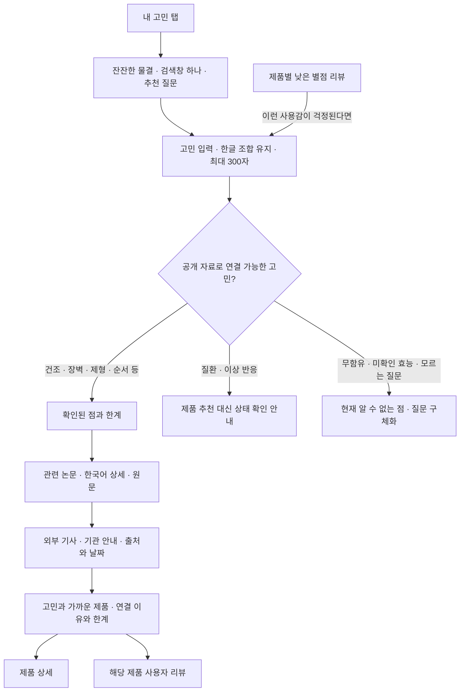

# 내 고민

추가일: 2026-11-03. 홈을 유지하고 주요 메뉴의 세 번째 위치에 추가한 기능입니다.

직접 진입: https://transparency-web-five.vercel.app/?view=concerns

## 화면과 흐름

건조함, 장벽, 가벼운 제형, 끈적임, 사용 순서·양, 민감성 확인 사항,
주름·탄력의 근거 범위 등 7개 주제로 연결합니다. 사용감·성분 역할에 따라
제품을 최대 2개 비교하며, 별점으로 제품군을 서열화하지 않습니다.
루틴 질문에 모든 제품 구매를 권하거나, 서로 다른 단계를 같은 기능의
대체품으로 보장하지 않습니다. 전체 전성분과 완제품 효능 시험이 없는
상황에서 무함유·인증·민감성 적합성·치료 효과를 추측하지 않습니다.

## 연구와 외부 자료

- 기존 검증 논문 데이터(`evidence-data.js`)를 재사용하며, 한국어 상세에서
  대상·조건·결과·한계와 원문을 확인할 수 있습니다.
- 글리세린과 세라마이드 NP 연구의 군간 차이 미확인 결과도 함께 연결합니다.
  성분·연구용 제형의 결과를 현재 완제품 효과로 바꾸어 표시하지 않습니다.
- `GET /api/concern-news?topic=dryness`처럼 허용된 주제 코드 하나만 요청합니다.
  검토한 기사와 기관 안내의 제목·매체·발행일·원문 주소를 반환합니다.
  최초 발행일이 확인되지 않은 안내는 `null`이며 화면에 ‘발행일 미표시’로 표시합니다.
- 실시간 뉴스 수집·본문 복제·RSS 피드 재배포는 하지 않습니다. ‘뉴스에서 더
  찾아보기’는 정해진 일반 주제어로 Google News를 여는 링크입니다.
- 원문 확인 기록은 [출처 검증 문서](concern-source-verification.md)에 있습니다.

## 리뷰와 개인정보

제품 상세의 낮은 별점 리뷰에서 해당 불편을 검색어로 선택할 수 있습니다.
선택한 리뷰 내용과 출발 제품은 현재 브라우저에서만 분석합니다. 준비된 리뷰는
개인화나 실제 사용 경험의 근거로 집계하지 않습니다. 비교 참고 대상은 이
브라우저에서 직접 작성한 유효한 별점 2점 이하의 관련 사용감 리뷰입니다.
별점만 낮거나 ‘끈적이지 않다’처럼 불편을 부정한 리뷰는 해당 불편의 근거가 아닙니다.

입력·결과는 메모리에만 유지되며 새로고침하면 사라집니다. 검색어·리뷰를
URL·브라우저 저장소·분석 도구·외부 검색 서비스로 자동 전송하지 않습니다.
화면 효과를 위해 입력 문장이나 HTML 화면을 이미지로 캡처하지 않습니다.
제품 상세의 Gemini 질문 기능은 별도 기능이며 기존 서버 API와 설정을 유지합니다.

## 상담에서 제안한 비교

기존 홈(A): `/` · 고민 검색(B): `/?view=concerns`.
상담이나 사용성 테스트에서 같은 대상에게 두 경로를 보여 주고, 근거를 찾기 쉬운지,
선택 이유를 납득하는지, 상품으로 이동하기 쉬운지 비교할 수 있습니다.
이번 구현에는 사용자 자동 배정·추적·통계 수집이 없으며 A/B 테스트를 실시했다고
주장하지 않습니다. 상담 중 언급된 브랜드 신뢰 비율은 조사 결과로 사용하지 않습니다.

## 구현 파일

| 파일 | 역할 |
| --- | --- |
| `main.js` | 다섯 메뉴·직접 진입·뒤로 가기·리뷰와 제품 연결 |
| `concerns.js`, `concerns.css` | 검색 상태·반응형 화면·연구 상세·외부 자료 연결 |
| `lib/concern-search.js`, `lib/concern-topics.js` | 로컬 고민 해석·정해진 주제·제품 연결 |
| `lib/concern-news-sources.js`, `api/concern-news.js` | 검토한 외부 출처와 주제 전용 API |
| `reviews.js`, `reviews.css` | 실제 작성 리뷰 읽기·불편 검색 버튼 |
| `concern-optics.js`, `concern-optics.css`, `concern-glass.css` | 물결 배경의 반응형 배치·포인터/터치 반응·일시정지·투명 검색창 |
| `liquid-surfaces.css` | 내비게이션·카드·탭·입력·모달 등 앱 전체의 투명 배경·경계·상태·블러 |
| `concern-water.js`, `liquid-scene.js` | HTML 샘플링·굴절·텍스처가 없는 물결 배경 전용 WebGL 그리기 |
| `tests/concern-search.test.mjs`, `tests/concern-news-api.test.mjs` | 연결 범위·자료·부정문·출처·개인정보·요청 검증 |

기존 모바일 와이어프레임·Figma 가져오기 자료는 이전 버전의 스냅샷입니다.
이 탭은 앱에 구현했으며 해당 설계 파일을 새 버전으로 생성한 것은 아닙니다.

## 화면 효과

### 현재 유리 재질

사용자 요청에 따라 콘텐츠의 굴절 적용을 제거했습니다. 원형 렌즈와 렌즈 제어
버튼, HTML 화면 캡처·전경 텍스처, 플로팅 표면의 SVG 배경 변형은 실행하지
않습니다. 운영체제의 기본 커서를 사용하며 화면 뒤의 글자·이미지가 휘거나
색으로 갈라지는 효과를 적용하지 않습니다.

`liquid-surfaces.css`의 공통 투명 재질과 기존 레이아웃은 유지합니다. 헤더·상하단
내비게이션·탭·필터에는 낮은 알파의 배경과 44px 배경 블러를, 제품 카드·리뷰·
질문·연구·구매 패널·입력 요소에는 32px 블러를 사용합니다. 얇은 경계와 은은한
반사색, 선택·호버 상태는 같은 CSS 변수로 관리하며 다크 모드의 별도 색상도
유지합니다. 콘텐츠·글자·이미지 전체의 불투명도 대신 표면 배경의 알파 값을
조절합니다. 주요 동작 버튼과 모달은 읽기 쉬운 대비를 유지합니다.

배경 블러 미지원 환경에서는 불투명 표면을 사용합니다. 투명도 감소·대비 증가·
강제 색상 설정에서는 명확한 배경이나 시스템 색상으로 전환해 읽기와 선택
상태를 유지합니다.

### 움직이는 물결 배경

‘내 고민’의 물결 배경은 유지합니다. 포인터는 물결의 흐름과 빛 방향에 반응하고,
터치는 물결에 파동을 만듭니다. 화면 폭에 맞춰 배경을 그리며 양옆을 제한하던
고정 최대 폭을 사용하지 않습니다. 배경 전용 WebGL 렌더러에는 굴절 계산과 HTML 샘플러가 없으며,
검색창에는 기본 HTML과 CSS 배경 블러를 사용합니다.

배경은 최대 30fps로 그리며 기기 배율·전체 픽셀 수를 제한합니다. 화면 밖이나
브라우저 탭이 숨겨진 상태에서는 멈추고, 동작 줄이기 설정에서는 정적인 장면을
표시합니다. 투명도 감소·강제 색상 설정에서는 배경 효과를 숨깁니다. WebGL 사용
불가·셰이더 오류·컨텍스트 손실 시에는 Canvas2D·CSS 배경으로 대체하며 검색창과
버튼은 계속 사용할 수 있습니다. 검색·테마·페이지 전환 시 이전 배경의 관찰·
애니메이션·GPU 자원을 해제합니다.

### 이전 구현 기록

이전에 검토한 HTML 캡처·원형 렌즈·유리 커서·SVG 표면 굴절은 현재 화면에서
제거한 실험입니다. `html-canvas-capture.js`, `glass-surfaces.js`,
`refractive-surfaces.css` 같은 이전 실험 파일이 남아 있어도 현재 앱 진입점에서
불러오거나 실행하지 않습니다.

시각적 참고 자료로 검토한 페이지:
[HTML in Canvas](https://liquidglassdesign.com/gallery/html-in-canvas),
[Music Player](https://liquidglassdesign.com/gallery/liquid-glass-music-player),
[Camera Toolbar](https://liquidglassdesign.com/gallery/liquid-glass-camera-toolbar),
[Olivier Larose — 3D Glass Effect](https://blog.olivierlarose.com/tutorials/3d-glass-effect).
해당 자료의 사진·영상·모델·폰트를 앱에 복제하지 않았습니다.

## 검증 기록

이번 굴절 제거 변경도 `npm test` 107개와 프로덕션 빌드를 통과했습니다.
Chromium의 1440px·390px에서 굴절 레이어·렌즈·제어 버튼이 없고 장식용 배경
Canvas 하나만 생성되는 것을 확인했습니다. HTML 캡처·텍스처 업로드가 없으며,
활성 셰이더에도 HTML 샘플러와 굴절 계산이 없습니다. 기본 커서와 네비게이션
44px·카드 32px·검색창 16px 블러는 유지됩니다. 한글 조합·검색·페이지 전환,
가로 넘침 없음, 숨김·동작 감소 시 정지와 GPU 자원 해제를 확인했습니다.

기존 검색 검증에서는
Chromium의 320·390·768·820·1024·1440px에서 메뉴와 가로 넘침, 한글 조합·검색·
논문 상세 닫기와 포커스·다크 모드·뒤로 가기·새로고침·직접 작성한 리뷰에서의
제품 비교를 확인했습니다. 네트워크에 정해진 주제 코드만 전달되고 고민 입력이
저장되지 않는 것도 확인했습니다. 실제 iOS·Android 기기에서 키보드와 스크린리더를
검증한 것은 아닙니다.
