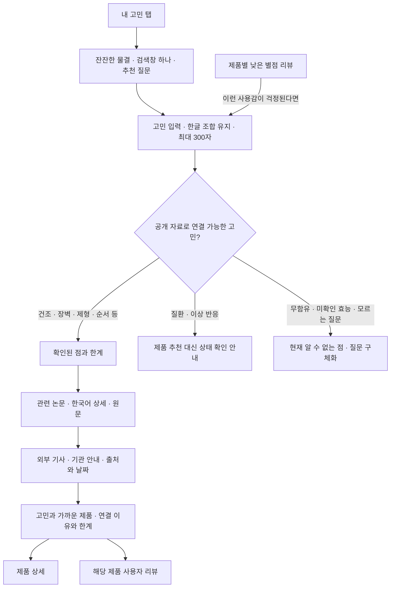

# 내 고민

추가일: 2026-11-03. 홈을 유지하고 주요 메뉴의 세 번째 위치에 추가한 기능입니다.

직접 진입: https://transparency-web-five.vercel.app/?view=concerns

## 화면과 흐름

건조함, 장벽, 가벼운 제형, 끈적임, 사용 순서·양, 민감성 확인 사항,
주름·탄력의 근거 범위 등 7개 주제로 연결합니다. 사용감·성분 역할에 따라
제품을 최대 2개 비교하며, 별점으로 제품군을 서열화하지 않습니다.
루틴 질문에 모든 제품 구매를 권하거나, 서로 다른 단계를 같은 기능의
대체품으로 보장하지 않습니다. 전체 전성분과 완제품 효능 시험이 없는
상황에서 무함유·인증·민감성 적합성·치료 효과를 추측하지 않습니다.

## 연구와 외부 자료

- 기존 검증 논문 데이터(`evidence-data.js`)를 재사용하며, 한국어 상세에서
  대상·조건·결과·한계와 원문을 확인할 수 있습니다.
- 글리세린과 세라마이드 NP 연구의 군간 차이 미확인 결과도 함께 연결합니다.
  성분·연구용 제형의 결과를 현재 완제품 효과로 바꾸어 표시하지 않습니다.
- `GET /api/concern-news?topic=dryness`처럼 허용된 주제 코드 하나만 요청합니다.
  검토한 기사와 기관 안내의 제목·매체·발행일·원문 주소를 반환합니다.
  최초 발행일이 확인되지 않은 안내는 `null`이며 화면에 ‘발행일 미표시’로 표시합니다.
- 실시간 뉴스 수집·본문 복제·RSS 피드 재배포는 하지 않습니다. ‘뉴스에서 더
  찾아보기’는 정해진 일반 주제어로 Google News를 여는 링크입니다.
- 원문 확인 기록은 [출처 검증 문서](concern-source-verification.md)에 있습니다.

## 리뷰와 개인정보

제품 상세의 낮은 별점 리뷰에서 해당 불편을 검색어로 선택할 수 있습니다.
선택한 리뷰 내용과 출발 제품은 현재 브라우저에서만 분석합니다. 준비된 리뷰는
개인화나 실제 사용 경험의 근거로 집계하지 않습니다. 비교 참고 대상은 이
브라우저에서 직접 작성한 유효한 별점 2점 이하의 관련 사용감 리뷰입니다.
별점만 낮거나 ‘끈적이지 않다’처럼 불편을 부정한 리뷰는 해당 불편의 근거가 아닙니다.

입력·결과는 메모리에만 유지되며 새로고침하면 사라집니다. 검색어·리뷰를
URL·브라우저 저장소·분석 도구·외부 검색 서비스로 자동 전송하지 않습니다.
제품 상세의 Gemini 질문 기능은 별도 기능이며 기존 서버 API와 설정을 유지합니다.

## 상담에서 제안한 비교

기존 홈(A): `/` · 고민 검색(B): `/?view=concerns`.
상담이나 사용성 테스트에서 같은 대상에게 두 경로를 보여 주고, 근거를 찾기 쉬운지,
선택 이유를 납득하는지, 상품으로 이동하기 쉬운지 비교할 수 있습니다.
이번 구현에는 사용자 자동 배정·추적·통계 수집이 없으며 A/B 테스트를 실시했다고
주장하지 않습니다. 상담 중 언급된 브랜드 신뢰 비율은 조사 결과로 사용하지 않습니다.

## 구현 파일

| 파일 | 역할 |
| --- | --- |
| `main.js` | 다섯 메뉴·직접 진입·뒤로 가기·리뷰와 제품 연결 |
| `concerns.js`, `concerns.css` | 검색 상태·반응형 화면·연구 상세·외부 자료 연결 |
| `lib/concern-search.js`, `lib/concern-topics.js` | 로컬 고민 해석·정해진 주제·제품 연결 |
| `lib/concern-news-sources.js`, `api/concern-news.js` | 검토한 외부 출처와 주제 전용 API |
| `reviews.js`, `reviews.css` | 실제 작성 리뷰 읽기·불편 검색 버튼 |
| `tests/concern-search.test.mjs`, `tests/concern-news-api.test.mjs` | 연결 범위·자료·부정문·출처·개인정보·요청 검증 |

기존 모바일 와이어프레임·Figma 가져오기 자료는 이전 버전의 스냅샷입니다.
이 탭은 앱에 구현했으며 해당 설계 파일을 새 버전으로 생성한 것은 아닙니다.

## 검증

### 유리 소재와 배경 인터랙션

검색창·버튼·정보 카드에 낮은 불투명도의 유리 표면, 배경 블러와 청록·자홍색의
광학 테두리를 적용했습니다. 검색창 뒤의 Canvas2D 유리 리본과 물결은 천천히
흐르며 포인터 위치에 따라 이동하고 반사광이 바뀝니다. 터치하면 잔물결이 퍼집니다.
텍스트와 입력 요소에는 왜곡을 적용하지 않습니다.

배경은 초당 30회까지 그리며 기기 배율·전체 픽셀 수를 제한합니다. 검색 영역이
화면 밖에 있거나 탭이 숨겨지면 멈추고, 검색·테마·페이지 전환 시 이전 리소스를
해제합니다. 동작 줄이기는 정적인 장면으로, 투명도 줄이기·강제 색상은 명확한
불투명 UI로 전환합니다. Canvas가 없어도 CSS 배경과 검색을 사용할 수 있습니다.
입력 문장·기기 센서·외부 이미지·추가 라이브러리는 배경 효과에 사용하지 않습니다.

파일: `concern-glass.css`, `concern-optics.css`, `concern-optics.js`.
Chromium에서 포인터 반응·검색 후 재초기화·반복 페이지 전환 시 루프 해제·화면 밖과
숨김 상태 일시정지·설정 변경을 확인했습니다. 320·390px의 높은 기기 배율, 실제
터치 스크롤 이벤트, Canvas 사용 불가 시의 검색도 확인했습니다.

`npm test` 전체 107개와 프로덕션 빌드를 통과했습니다. Chromium의 320·390·768·820·1024·1440px에서
메뉴와 가로 넘침을 확인했습니다. 한글 조합·검색·논문 상세 닫기와 포커스·펼침 상태·다크 모드·
뒤로 가기·새로고침·실제 작성 리뷰에서의 제품 비교를 확인했으며, 네트워크에는 정해진
주제 코드만 전달되고 고민 입력은 저장되지 않는 것을 검증했습니다. 실제 iOS·Android 기기에서
키보드와 스크린리더를 검증한 것은 아닙니다.
