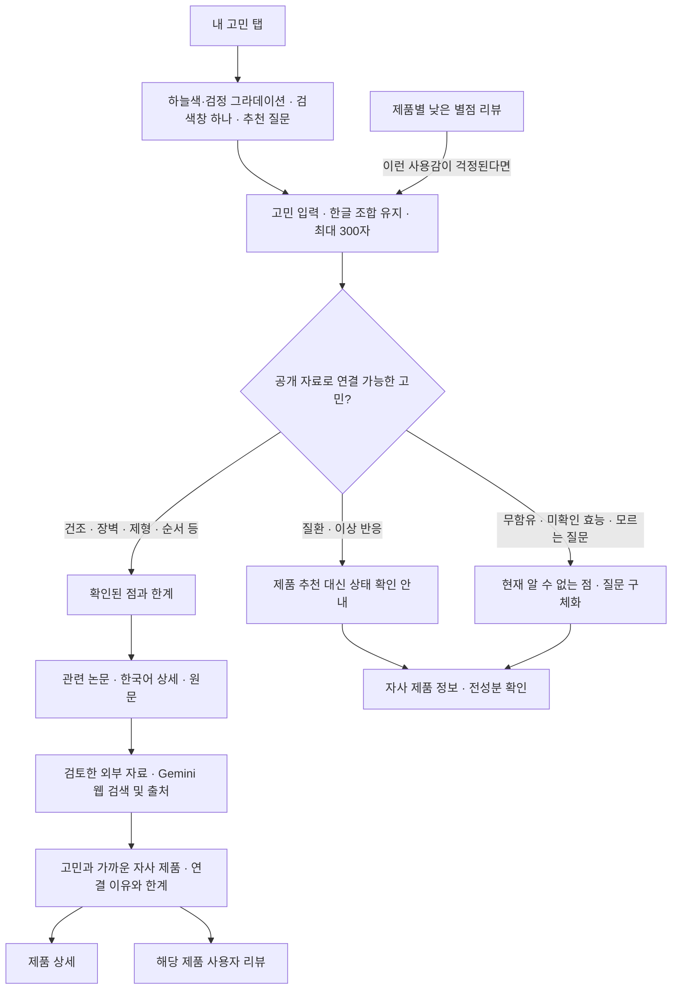

# 내 고민

추가일: 2026-11-03. 홈을 유지하고 주요 메뉴의 세 번째 위치에 추가한 기능입니다.

직접 진입: https://transparency-web-five.vercel.app/?view=concerns

## 화면과 흐름

건조함, 장벽, 가벼운 제형, 끈적임, 사용 순서·양, 민감성 확인 사항,
주름·탄력의 근거 범위 등 7개 주제로 연결합니다. 사용감·성분 역할에 따라
제품을 최대 2개 비교하며, 별점으로 제품군을 서열화하지 않습니다.
일치하는 추천이 없는 질문에는 자사 제품 3개의 일반 정보를 별도로 보여 줍니다.
이는 해당 고민의 치료 효과나 개인에게 맞는 제품이라는 뜻이 아닙니다. 저자극·알레르기 관련 인증이나 시험 결과는 아직 제공되지 않았으므로 의료·알레르기 등 확인이 필요한 질문에는 그 점과 전성분 확인을 안내합니다.
루틴 질문에 모든 제품 구매를 권하거나, 서로 다른 단계를 같은 기능의
대체품으로 보장하지 않습니다. 전체 전성분과 완제품 효능 시험이 없는
상황에서 무함유·인증·민감성 적합성·치료 효과를 추측하지 않습니다.

## 연구와 외부 자료

- 기존 검증 논문 데이터(`evidence-data.js`)를 재사용하며, 한국어 상세에서
  대상·조건·결과·한계와 원문을 확인할 수 있습니다.
- 글리세린과 세라마이드 NP 연구의 군간 차이 미확인 결과도 함께 연결합니다.
  성분·연구용 제형의 결과를 현재 완제품 효과로 바꾸어 표시하지 않습니다.
- `GET /api/concern-news?topic=dryness`처럼 허용된 주제 코드 하나만 요청합니다.
  검토한 기사와 기관 안내의 제목·매체·발행일·원문 주소를 반환합니다.
  최초 발행일이 확인되지 않은 안내는 `null`이며 화면에 ‘발행일 미표시’로 표시합니다.
- 실시간 뉴스 수집·본문 복제·RSS 피드 재배포는 하지 않습니다. ‘뉴스에서 더
  찾아보기’는 정해진 일반 주제어로 Google News를 여는 링크입니다.
- 원문 확인 기록은 [출처 검증 문서](concern-source-verification.md)에 있습니다.
- AI 자료 안내는 별도의 `POST /api/concern-ai`에서 Gemini의 Google 검색 연결을 사용합니다. 검색 연결이 제한될 때는 관련 주제에 대해 Europe PMC 공개 연구자료를 검색하고 Gemini가 확인된 논문을 요약하는 대체 경로를 사용합니다. 연구자료 검색은 웹 전체 검색과 구분해 표시합니다. 출처를 확인할 수 없거나 연결이 실패하면 기존 자료와 제품 비교는 계속 이용할 수 있습니다.
- 일반 질문에는 `POST /api/concern-creative`에서 Gemini가 질문과 자사 제품을 잇는 짧은 비유를 만듭니다. 제품의 제형과 사용 단계는 등록된 제품 정보에서 따로 가져옵니다. 건강·알레르기 등 제품 사용의 적합성을 판단할 수 없거나 비유가 부적절한 질문에는 창작 연결을 표시하지 않습니다.

## 리뷰와 개인정보

제품 상세의 낮은 별점 리뷰에서 해당 불편을 검색어로 선택할 수 있습니다.
선택한 리뷰 내용과 출발 제품은 현재 브라우저에서만 분석합니다. 준비된 리뷰는
개인화나 실제 사용 경험의 근거로 집계하지 않습니다. 비교 참고 대상은 이
브라우저에서 직접 작성한 유효한 별점 2점 이하의 관련 사용감 리뷰입니다.
별점만 낮거나 ‘끈적이지 않다’처럼 불편을 부정한 리뷰는 해당 불편의 근거가 아닙니다.

이 사이트는 입력·결과를 브라우저 저장소에 보관하지 않으며 화면의 내용은 새로고침하면 사라집니다. AI 제품 연결이나 웹 검색을 요청하면 입력된 질문이 서버와 Google Gemini에 전달되고, 웹 검색 시 관련 검색어가 Google 검색에 사용될 수 있습니다. Google은 검색에 사용된 질문·문맥과 응답을 30일간 보관합니다. 리뷰 전체는 보내지 않으며, 리뷰에서 유입된 질문의 AI 요청은 사용자의 별도 요청으로 시작합니다. 폼에 이 전송과 민감정보 입력 주의가 표시됩니다. 화면 효과를 위해 입력 문장이나 HTML 화면을 이미지로 캡처하지 않습니다. 제품 상세의 Gemini 질문 기능은 별도 API입니다.

## 상담에서 제안한 비교

기존 홈(A): `/` · 고민 검색(B): `/?view=concerns`.
상담이나 사용성 테스트에서 같은 대상에게 두 경로를 보여 주고, 근거를 찾기 쉬운지,
선택 이유를 납득하는지, 상품으로 이동하기 쉬운지 비교할 수 있습니다.
이번 구현에는 사용자 자동 배정·추적·통계 수집이 없으며 A/B 테스트를 실시했다고
주장하지 않습니다. 상담 중 언급된 브랜드 신뢰 비율은 조사 결과로 사용하지 않습니다.

## 구현 파일

| 파일 | 역할 |
| --- | --- |
| `main.js` | 다섯 메뉴·직접 진입·뒤로 가기·리뷰와 제품 연결·전역 배경 초기화 |
| `concerns.js`, `concerns.css` | 검색 상태·반응형 화면·연구 상세·외부 자료 연결 |
| `lib/concern-search.js`, `lib/concern-topics.js` | 로컬 고민 해석·정해진 주제·제품 연결 |
| `lib/concern-news-sources.js`, `api/concern-news.js` | 검토한 외부 출처와 주제 전용 API |
| `lib/concern-ai-provider.js`, `lib/concern-research-provider.js`, `api/concern-ai.js` | Gemini 검색·공개 연구자료 대체 경로와 출처 검증 API |
| `lib/concern-creative-provider.js`, `api/concern-creative.js` | 일반 질문과 제품을 연결하는 AI 비유 |
| `reviews.js`, `reviews.css` | 실제 작성 리뷰 읽기·불편 검색 버튼 |
| `concern-optics.css`, `concern-glass.css` | ‘내 고민’의 반응형 검색 영역·투명 검색창 |
| `concern-atmosphere.css` | 빈 검색 화면의 큰 타이포그래피와 배치; 전용 색상은 공통 효과 CSS에서 조정 |
| `ambient-background.js`, `site-background.js`, `site-effects-config.js` | 앱 전체 단일 그레인 그라데이션·전역 포인터 곡률·효과 감소 설정 |
| `background-motion.js` | 이동 경로의 누적 변형·회전·위상과 느린 완화 |
| `backdrop-ink.js` | 배경 위 전경 문구의 검정 고정·읽기 카드와 밝은 선택 컨트롤 제외 |
| `site-text-effects.js`, `site-wide-text-lens.js`, `site-effects.css` | 대표 제목의 한영 레이어·일반 정적 문구의 원문 렌즈·공통 가독성 |
| `scroll-position.js`, `scroll-position.css` | 오른쪽 31개 눈금과 삼각형 스크롤 위치 표시·모바일 축소 형태 |
| `liquid-surfaces.css` | 내비게이션·카드·탭·입력·모달 등 앱 전체의 투명 배경·경계·상태·블러 |
| `tests/concern-search.test.mjs`, `tests/concern-news-api.test.mjs` | 연결 범위·자료·부정문·출처·개인정보·요청 검증 |

기존 모바일 와이어프레임·Figma 가져오기 자료는 이전 버전의 스냅샷입니다.
이 탭은 앱에 구현했으며 해당 설계 파일을 새 버전으로 생성한 것은 아닙니다.

## 화면 효과

### 현재 공통 효과

모든 메뉴가 흰색과 아이스 블루·하늘색·블루의 큰 색 영역이 서로 밀고 섞이는 유체 그라데이션과 고정 Canvas를 공유합니다.
기본 화면은 라이트이며 헤더에서 다크 모드로 전환할 수 있습니다. 다크 모드는 영상의 검정·남색·청록·오렌지 팔레트를 사용합니다. 배경 전체 밝기 하한과
전체 흰색 막은 없습니다. 렌즈 중심의 중력장·회전과 누적 이동 경로에 따라 색 흐름이
겹치고 휘며, 스크롤은 같은 흐름에 힘을 더합니다. 빈 검색·검색 결과·메뉴 전환에서
다른 팔레트나 장면으로 갑자기 교체하지 않습니다.
입자 셀은 출력 기준 1.3px, 강도는 .045이며 내부 배경과 별도 해상도로 합성합니다.

한 손가락 터치와 스크롤도 passive 이벤트로 반영하며 네이티브 스크롤을 막지 않습니다.
이동 이력은 휘발성 메모리에만 유지하고 천천히 완화하며, coarse 포인터 기기에서는
자동 흐름이 2배가 됩니다. 동작 줄이기·투명도 감소·고대비·강제 색상에서는 이력을
초기화해 정적으로 표시하고, 비활성 탭에서는 일시 정지합니다.

헤더와 내비게이션은 12–22% 흰색 채움과 24px 블러를 사용합니다. 배경 위에 직접 놓인
등록 문구는 라이트에서 검정, 다크에서 밝은 색으로 표시합니다. 배경의 순간 밝기에 따라 전환하지 않습니다.
검색창과 읽기 카드도 선택한 테마에 맞춥니다.

한국어 원문을 기본으로 사용합니다. 넓은 마우스 화면에서만 대표 제목의 원 안이 영어로
바뀌며, 배경 위 제목의 한영 대응 줄은 같은 검정을 사용합니다. 원형 커서는 데스크톱 전역과 메뉴 이동 후에도 유지합니다. 16px 이상 비조작 정적
문구에만 글자 효과를 적용하고 일반 문구는 번역하지 않습니다. 메뉴·버튼·링크·입력·
펼침 컨트롤과 16px 미만의 작은 글자는 제외합니다. 기본 설정에서 중심부를
약 11% 선명하게 확대하고, 빨강·노랑과 파랑·청록의 색 분리는 중심의 거의 0에서 원 경계의 최대 5.2px까지
반경의 세제곱에 따라 연속적으로 증가합니다. 얇은 외곽 굴절은 유지하며 원 밖은
네이티브 글자를 그대로 표시합니다. 분리된 색 날개는 100% 불투명도로 본체 밖에 그립니다. 굴절값이 0이면 확대와 색 분리도 사라집니다.
모바일·터치·750px 이하에서는 전환 버튼 없이 한국어 HTML만 표시합니다.
입력 필드·편집 영역·사진은 텍스트 굴절 대상에서 제외하며, 표시된 정적 문장만 로컬 텍스처로
다시 그립니다. 제품 사진 위에서는 같은 렌즈의 원 안에만 제형 이미지를 표시합니다. 전체 페이지 이미지 캡처나 렌즈 문구의 서버 전송은 없습니다.
기본 스크롤과 네이티브 입력을 유지하고 동작 줄이기·WebGL 대체 화면을 지원합니다.

화면 오른쪽에는 31개 눈금과 삼각형으로 스크롤 위치를 표시하며 데스크톱 폭 26px·긴 눈금 12px, 모바일 폭 12px·긴 눈금 6px로 표시합니다.
스크롤할 내용이 없으면 숨기며, 클릭·포커스·스크롤 이동을 가로채지 않습니다.

설정·설치·검증 방법은 [공통 사이트 효과](site-effects.md)를 확인하세요.

### 이전 구현 기록

이전에 검토한 전체 HTML 캡처·유리 커서·SVG 표면 굴절은 현재 화면에서
제거한 실험입니다. 현재 대표 제목 렌즈는 HTML 전체를 캡처하는 방식과 다릅니다. ‘내 고민’ 안에만 있던 배경도 전역 배경으로 대체했습니다.
`concern-optics.js`, `concern-water.js`, `liquid-scene.js`,
`html-canvas-capture.js`, `glass-surfaces.js`,
`refractive-surfaces.css` 같은 이전 실험 파일이 남아 있어도 현재 앱 진입점에서
불러오거나 실행하지 않습니다.

시각적 참고 자료로 검토한 페이지:
[HTML in Canvas](https://liquidglassdesign.com/gallery/html-in-canvas),
[Music Player](https://liquidglassdesign.com/gallery/liquid-glass-music-player),
[Camera Toolbar](https://liquidglassdesign.com/gallery/liquid-glass-camera-toolbar),
[Olivier Larose — 3D Glass Effect](https://blog.olivierlarose.com/tutorials/3d-glass-effect).
해당 자료의 사진·영상·모델·폰트를 앱에 복제하지 않았습니다.

## 검증 기록

Node 테스트 113개·프로덕션 빌드·광학/배경/입자 GPU 검증가 통과했습니다.
버튼·메뉴·16px 미만 글자의 렌즈 제외, 혼합 본문의 작은 주석 제외, 눈금의 0·50·100%
위치와 짧은 문서 숨김을 확인했습니다. 320px의 8개 화면과 390px 모바일에서 한국어·입력·
축소 눈금·가로 넘침 없음, 실제 모바일 스와이프와 배경 이력 반영도 확인했습니다.
같은 시간·포인터 위치에서 이동 경로에 따른 실제 픽셀 차이와 경로 재현성은 GPU에서 검증합니다.
자세한 범위는 [공통 사이트 효과](site-effects.md)를 확인하세요.

기존 검색 검증은 Chromium의 320·390·768·820·1024·1440px에서 메뉴·가로 넘침·
한글 조합·검색·논문 상세 닫기·포커스·뒤로 가기·새로고침·리뷰에서 제품 비교를
확인했습니다. 이 기록은 AI 웹 검색을 추가하기 전 동작에 관한 것으로, 당시에는 뉴스 주제 코드만 서버로 전송했습니다. 실제 iOS·Android 기기의 키보드·스크린리더·GPU 성능을 검증한 기록은 아닙니다.

파스텔·무채색 배경과 검색 전용 장면의 이전 검증은 당시 구현에 관한 기록입니다.
그때의 밝기 하한·고정 대비 수치·검색 결과의 장면 전환·텍스처 미생성은 현재 동작으로 안내하지 않습니다. 현재 라이트 배경은 흰색·아이스 블루·파랑을 사용하고 다크 배경은 별도의 어두운 팔레트를 사용합니다. 전경 문구는 테마에 맞춰 바꾸며 정적 문구 렌즈를 위해 로컬 텍스처를 생성합니다.
세 GPU 스크립트만으로 전역 정적 문구 렌즈와 전경 글자 표시의 전체 화면 검증을
대체하지 않습니다.
