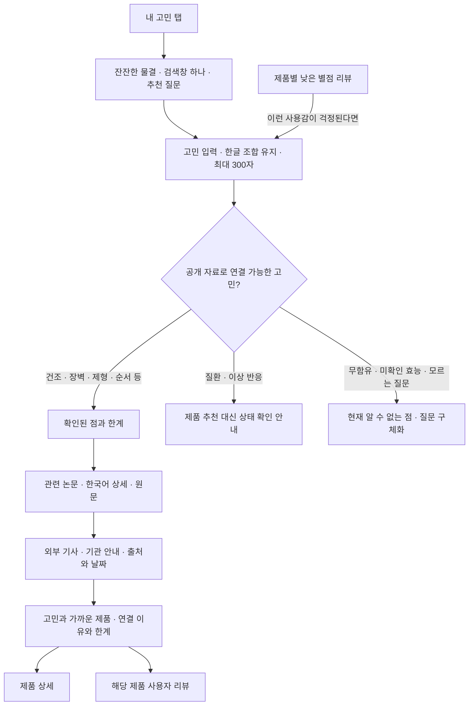

# 내 고민

추가일: 2026-11-03. 홈을 유지하고 주요 메뉴의 세 번째 위치에 추가한 기능입니다.

직접 진입: https://transparency-web-five.vercel.app/?view=concerns

## 화면과 흐름

건조함, 장벽, 가벼운 제형, 끈적임, 사용 순서·양, 민감성 확인 사항,
주름·탄력의 근거 범위 등 7개 주제로 연결합니다. 사용감·성분 역할에 따라
제품을 최대 2개 비교하며, 별점으로 제품군을 서열화하지 않습니다.
루틴 질문에 모든 제품 구매를 권하거나, 서로 다른 단계를 같은 기능의
대체품으로 보장하지 않습니다. 전체 전성분과 완제품 효능 시험이 없는
상황에서 무함유·인증·민감성 적합성·치료 효과를 추측하지 않습니다.

## 연구와 외부 자료

- 기존 검증 논문 데이터(`evidence-data.js`)를 재사용하며, 한국어 상세에서
  대상·조건·결과·한계와 원문을 확인할 수 있습니다.
- 글리세린과 세라마이드 NP 연구의 군간 차이 미확인 결과도 함께 연결합니다.
  성분·연구용 제형의 결과를 현재 완제품 효과로 바꾸어 표시하지 않습니다.
- `GET /api/concern-news?topic=dryness`처럼 허용된 주제 코드 하나만 요청합니다.
  검토한 기사와 기관 안내의 제목·매체·발행일·원문 주소를 반환합니다.
  최초 발행일이 확인되지 않은 안내는 `null`이며 화면에 ‘발행일 미표시’로 표시합니다.
- 실시간 뉴스 수집·본문 복제·RSS 피드 재배포는 하지 않습니다. ‘뉴스에서 더
  찾아보기’는 정해진 일반 주제어로 Google News를 여는 링크입니다.
- 원문 확인 기록은 [출처 검증 문서](concern-source-verification.md)에 있습니다.

## 리뷰와 개인정보

제품 상세의 낮은 별점 리뷰에서 해당 불편을 검색어로 선택할 수 있습니다.
선택한 리뷰 내용과 출발 제품은 현재 브라우저에서만 분석합니다. 준비된 리뷰는
개인화나 실제 사용 경험의 근거로 집계하지 않습니다. 비교 참고 대상은 이
브라우저에서 직접 작성한 유효한 별점 2점 이하의 관련 사용감 리뷰입니다.
별점만 낮거나 ‘끈적이지 않다’처럼 불편을 부정한 리뷰는 해당 불편의 근거가 아닙니다.

입력·결과는 메모리에만 유지되며 새로고침하면 사라집니다. 검색어·리뷰를
URL·브라우저 저장소·분석 도구·외부 검색 서비스로 자동 전송하지 않습니다.
유리 렌즈는 현재 보이는 화면의 HTML을 로컬 이미지로 만들므로 입력값이 스냅샷에 포함될 수
있습니다. 이 이미지는 현재 브라우저의 메모리·GPU 텍스처에만 유지하며 파일로
저장하거나 서버로 업로드하지 않습니다. 페이지 전환 시 관련 캡처와 GPU 자원을 해제합니다.
제품 상세의 Gemini 질문 기능은 별도 기능이며 기존 서버 API와 설정을 유지합니다.

## 상담에서 제안한 비교

기존 홈(A): `/` · 고민 검색(B): `/?view=concerns`.
상담이나 사용성 테스트에서 같은 대상에게 두 경로를 보여 주고, 근거를 찾기 쉬운지,
선택 이유를 납득하는지, 상품으로 이동하기 쉬운지 비교할 수 있습니다.
이번 구현에는 사용자 자동 배정·추적·통계 수집이 없으며 A/B 테스트를 실시했다고
주장하지 않습니다. 상담 중 언급된 브랜드 신뢰 비율은 조사 결과로 사용하지 않습니다.

## 구현 파일

| 파일 | 역할 |
| --- | --- |
| `main.js` | 다섯 메뉴·직접 진입·뒤로 가기·리뷰와 제품 연결 |
| `concerns.js`, `concerns.css` | 검색 상태·반응형 화면·연구 상세·외부 자료 연결 |
| `lib/concern-search.js`, `lib/concern-topics.js` | 로컬 고민 해석·정해진 주제·제품 연결 |
| `lib/concern-news-sources.js`, `api/concern-news.js` | 검토한 외부 출처와 주제 전용 API |
| `reviews.js`, `reviews.css` | 실제 작성 리뷰 읽기·불편 검색 버튼 |
| `concern-optics.js`, `concern-optics.css`, `concern-glass.css` | 배경·유리구의 반응형 배치·공유 애니메이션·입력 보호·유리 표면 |
| `html-canvas-capture.js` | 현재 뷰포트 HTML의 로컬 스냅샷·고정 메뉴 좌표 보정·중복 요청 병합·오래된 결과 폐기 |
| `concern-lens.js`, `liquid-scene.js` | 배경·HTML 텍스처의 WebGL 굴절과 반사 |
| `tests/concern-search.test.mjs`, `tests/concern-news-api.test.mjs` | 연결 범위·자료·부정문·출처·개인정보·요청 검증 |

기존 모바일 와이어프레임·Figma 가져오기 자료는 이전 버전의 스냅샷입니다.
이 탭은 앱에 구현했으며 해당 설계 파일을 새 버전으로 생성한 것은 아닙니다.

## 검증

### 유리 소재와 배경 인터랙션

검색창과 검색 버튼 자체를 렌즈로 구현했습니다. 바깥에서 보이는 움직이는 물결과
유리 안에서 보이는 물결은 같은 절차적 배경 함수입니다. 캡슐의 SDF와 곡면 법선을
이용해 굴절 방향을 계산하고, 둥근 가장자리의 확대·왜곡과 국소적인 색수차를
표현합니다. 무지개 외곽선과 큐브는 제거했습니다.

실제 HTML 검색창·버튼의 위치와 크기를 CSS 픽셀로 측정해 WebGL 렌즈와 일치시킵니다.
포인터는 넓은 배경 흐름과 반사 방향을 바꾸고, 터치는 배경 자체를 휘는 파동을 만듭니다.
WebGL이 켜져 있을 때 검색창의 CSS 블러를 끄므로 실제 굴절을 가리지 않습니다.

작은 유리 렌즈는 ‘내 고민’에서 현재 화면에 보이는 전체 HTML을 대상으로 합니다.
헤더·검색 영역뿐 아니라 스크롤한 위치의 논문·기사·제품 카드·푸터도 포함합니다.
`html-to-image` 1.11.13으로 실제 DOM을 복제한 뒤 SVG `foreignObject` → 고해상도
Canvas → WebGL 텍스처 순서로 변환합니다. 긴 문서 전체를 거대한 이미지로 만들지 않고
현재 뷰포트 크기로 잘라 그리며, 고정·스티키 요소는 현재 화면 좌표에 맞춰 보정합니다.
브라우저의 실험적 HTML-in-Canvas API를 요구하지 않습니다.

렌즈 지름은 PC 84 CSS px, 터치 포인터 68 CSS px입니다. 화면 크기의 저해상도
Canvas를 렌즈에 확대하던 방식에서 벗어나, 렌즈 크기의 작은 Canvas를 배경과
별도로 2~3배 배율로 그립니다. 원본 HTML 스냅샷도 기본 2~3배 배율로 만들되
800만 픽셀과 기기의 WebGL 최대 텍스처 크기를 넘지 않도록 배율을 제한합니다.
복제 과정에서 잘리던 소수점 글자 크기를 복원하고, SVG 자체의 실제 래스터 크기를
먼저 높여 저해상도 이미지를 나중에 확대하는 문제를 줄였습니다. ‘내 고민’ 화면에는
원본 HTML과 캡처에서 공통으로 사용하는 시스템 글꼴을 적용합니다.

구의 앞면과 뒷면에서 광선의 교차 위치와 스넬 법칙에 따른 굴절 방향을 계산하고,
각 RGB 채널의 굴절률을 조금씩 달리해 가장자리 색수차를 표현합니다. 곡면 반사와
명암을 더한 이 광학 셰이더는 프로젝트에서 직접 작성한 GLSL입니다.

원본 HTML 검색창·버튼·제목은 그대로 남아 있습니다. 렌즈 Canvas는 포인터 입력과
스크린리더 탐색을 가로채지 않으며, 검색창에 초점을 두거나 한글을 조합할 때는
사라져서 커서와 조합 글자를 가리지 않습니다. 포인터·터치 위치를 따라 화면 전역에서
이동하고 ‘유리 렌즈 켜기·끄기’ 버튼으로 효과를 전환할 수 있습니다. 스크롤 중에는
오래된 화면이 렌즈에 남지 않도록 숨기고, 스크롤이 약 140ms 멈추면 현재 뷰포트를
다시 캡처합니다. 상세 모달이 열려 있는 동안에도 렌즈를 숨깁니다.

배경 Canvas와 렌즈 레이어·제어 버튼은 캡처에서 제외해 재귀 캡처를 막습니다.
입력·크기·글꼴·스크롤·콘텐츠 상태 변화에 맞춰 최신 이미지를 다시 만들며,
중복 요청은 병합하고 오래된 결과는 폐기합니다. 같은 출처의 이미지와
`data:`·`blob:` 이미지만 포함하며, 캡처 과정에서 외부 웹폰트나 다른 출처의
자산을 추가로 가져오지 않습니다.

배경의 최대 1440px 제한을 제거하고 스크롤바를 제외한 실제 화면 폭으로 그립니다.
1920px 이상에서도 화면 중간에 캔버스의 양옆 경계가 나타나지 않도록 했습니다.
유리 반사에는 청록·라벤더·샴페인빛을 부드럽게 섞고, 곡면 가장자리의 RGB 분리를
2.6 CSS 픽셀까지 적용했습니다. 색은 유리 표면과 반사부에 집중하고 흑백 배경과
선명한 입력 글자를 유지합니다. WebGL 미지원 시의 CSS 유리에도 같은 색감을 사용합니다.

배경과 작은 HTML 렌즈의 Canvas 두 개는 최대 30fps 애니메이션 루프를 공유합니다.
배경은 기존의 낮은 픽셀 예산을 유지하고 렌즈는 작은 영역에 높은 픽셀 밀도를
배정합니다. 일시적인 캡처 Canvas는 텍스처 업로드 후 해제합니다. 상단 배경이
화면 밖으로 나가면 배경 그리기를 멈추지만 렌즈는 현재 뷰포트에서 계속 움직입니다.
브라우저 탭이 숨겨지면 애니메이션을 멈추고, 검색·테마·페이지 전환 시 이전 리소스를
해제합니다. 동작 줄이기는 정적인 장면으로, 투명도 줄이기·강제 색상은 명확한
불투명 UI로 전환합니다. WebGL 사용 불가·셰이더 오류·그래픽 컨텍스트 손실 시에는
Canvas2D·CSS의 배경 흐름과 블러 유리로 전환합니다. 이때 굴절은 생략되지만 검색은
계속 사용할 수 있습니다. GPU 리소스와 컨텍스트는 페이지가 바뀔 때 명시적으로 해제합니다.
HTML 캡처에 입력값이 포함될 수 있지만 캡처 결과를 저장·전송하지 않으며 기기 센서를 사용하지 않습니다.

고해상도 캡처를 처리할 때는 애니메이션을 잠시 멈춰 래스터화에 시간을 배정하고,
완료 후 다시 움직입니다. 포인터가 이동할 때마다 캡처하지 않고 최신 텍스처를
재사용합니다. 검색창에 초점이 있거나 한글 조합 중일 때는 캡처를 미루고,
초점이 빠져나오면 최신 입력과 화면을 반영합니다.

HTML 캡처는 브라우저의 SVG `foreignObject`·Canvas 지원에 영향을 받습니다.
Safari 등에서는 동작이 다를 수 있으며, 캡처가 실패하면 유리구를 숨기고 원본 HTML
검색창과 버튼을 계속 제공합니다. 현재 확인 범위는 Chromium이며 실제 iOS·Android
기기에서 검증한 결과는 아닙니다.

파일: `concern-glass.css`, `concern-optics.css`, `concern-optics.js`, `concern-lens.js`, `liquid-scene.js`, `html-canvas-capture.js`.
이전 상단 렌즈 버전에서는 Chromium에서 포인터 반응·검색 후 재초기화·반복 페이지 전환 시 루프 해제·화면 밖과
숨김 상태 일시정지·설정 변경을 확인했습니다. 320·390px의 높은 기기 배율, 실제
터치 스크롤 이벤트, Canvas 사용 불가 시의 검색도 확인했습니다.

같은 시간·배경에서 굴절 강도만 1과 0으로 바꾼 프레임 비교로 유리 안쪽의 차이와
유리 바깥의 동일함을 확인했습니다. 검색창·버튼의 HTML 경계와 셰이더 좌표도
320·390·768·1440px, 라이트·다크 모드에서 비교했습니다.

이전 캡처 모듈의 독립 Chromium 테스트에서는 실제 한글 제목·입력값·버튼·같은 출처 이미지가
SVG `foreignObject`와 Canvas에 포함되는 것을 확인했습니다. 배경·유리구 레이어는
제외됐으며, 중복 캡처 병합·진행 중 요청 무효화·해제 후 콜백 차단도 확인했습니다.
이 확인은 HTML 캡처 모듈의 범위이며 실제 기기의 GPU 성능을 측정한 결과는 아닙니다.

이전 상단 렌즈의 통합 화면에서는 라이트·다크 모드의 390·1440px에서 유리구가 실제 제목을
확대·굴절하는 모습을 확인했습니다. 캡처 이미지의 실제 WebGL 업로드와 제목 픽셀,
한글 조합 중 입력 요소 유지·Enter 검색 방지·렌즈 숨김을 별도로 확인했습니다.
동작 줄이기·WebGL 미지원·강제 색상·캡처 실패 시에도 한국어 검색이 가능했습니다.
이 대체 동작 검사는 소프트웨어 GPU 부하를 피하기 위해 그리기만 생략했으며,
시각적 굴절 확인은 실제 그리기가 실행되는 별도 검사에서 수행했습니다.

이번 뷰포트 확장에서는 실제 WebGL을 사용하는 1440px·DPR 1, 390px·DPR 3
화면을 확인했습니다. 렌즈 출력은 각각 92×92 CSS px에 184×184 픽셀,
76×76 CSS px에 228×228 픽셀이며, 투명 여백을 제외한 렌즈 지름은 84·68px입니다.
HTML 원본 텍스처는 2880×1800, 1170×2700 픽셀로 올라갑니다. 고정 헤더·
실제 제목의 픽셀과 스크롤 후 연구 영역·푸터 캡처, 가로 넘침 없음을 확인했습니다.
독립 캡처 검사에서는 스크롤 0·300·900px에서 일반·fixed·sticky 요소의 위치,
중복 캡처·해제·최대 텍스처 크기 제한도 확인했습니다.

기본 HTML 조작과 자원 해제 검사에서는 느린 소프트웨어 GPU의 그리기만 생략하고
네이티브 검색·한글 조합·렌즈 전환·헤더/연구/푸터에서의 포인터 추적을 검증했습니다.
화면 전환 후 렌즈 레이어와 이전 GPU 자원이 해제되고 다시 진입하면 화면 Canvas
두 개만 연결되는 것을 확인했습니다. 실제 기기의 GPU 성능 측정은 아닙니다.

시각적 참고:
[HTML in Canvas](https://liquidglassdesign.com/gallery/html-in-canvas),
[Music Player](https://liquidglassdesign.com/gallery/liquid-glass-music-player),
[Camera Toolbar](https://liquidglassdesign.com/gallery/liquid-glass-camera-toolbar),
[Olivier Larose — 3D Glass Effect](https://blog.olivierlarose.com/tutorials/3d-glass-effect).
갤러리의 사진·영상·코드는 앱에 포함하지 않았습니다. Olivier Larose 튜토리얼은
Three.js·React Three Fiber·Drei의 `MeshTransmissionMaterial`과 WebGL Text를 사용하는
3D 장면입니다. 이 프로젝트는 해당 저장소의 코드·모델·폰트를 복제하거나 Drei를
도입한 것이 아니라, 직접 작성한 GLSL 광학 계산에 실제 HTML 텍스처를 연결합니다.
배경·렌즈 셰이더는 이 프로젝트에서 직접 작성했고,
HTML 캡처에는 [html-to-image](https://github.com/bubkoo/html-to-image) 1.11.13(MIT)을 사용합니다.

이번 뷰포트 확장·화질 개선에서도 `npm test` 107개와 프로덕션 빌드를 통과했습니다. 기존 검색 검증에서는 Chromium의 320·390·768·820·1024·1440px에서
메뉴와 가로 넘침을 확인했습니다. 한글 조합·검색·논문 상세 닫기와 포커스·펼침 상태·다크 모드·
뒤로 가기·새로고침·실제 작성 리뷰에서의 제품 비교를 확인했으며, 네트워크에는 정해진
주제 코드만 전달되고 고민 입력은 저장되지 않는 것을 검증했습니다. 실제 iOS·Android 기기에서
키보드와 스크린리더를 검증한 것은 아닙니다.
